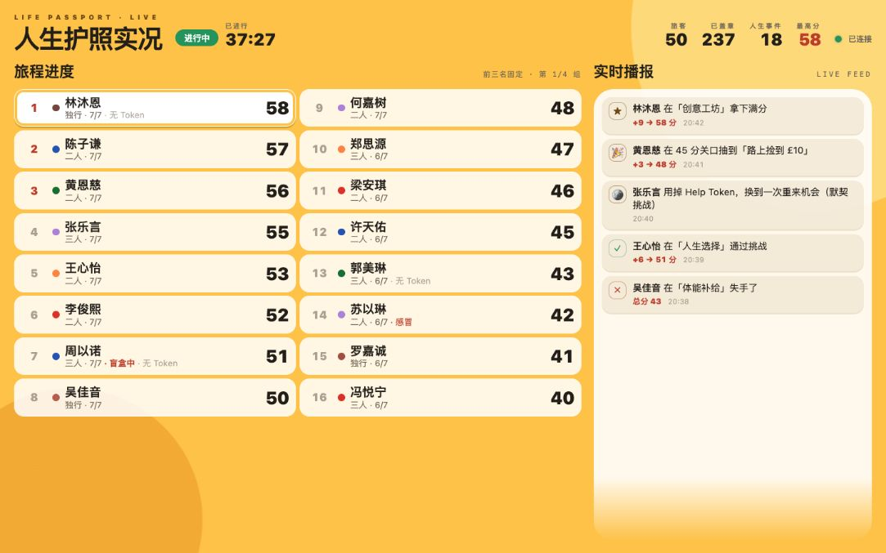
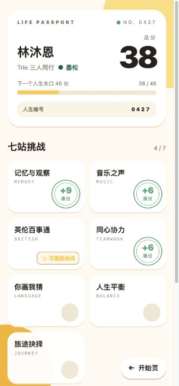

# CrowdPlay

**A platform for running in-person events from people's phones.** Players join by scanning a QR code. Staff score them at physical stations. Players trigger random life events on their phones, and a projector screen shows the room live, ending in an awards ceremony. The organisers run it all from a two-level admin console.

It was built for and first used at a ~50-person welcome party for international students at a UK church, played on phones inside WeChat. The first built-in theme is *Life Passport* (人生护照): every player lives three "life stages" while their team works through seven stations.

<p>
  
  
</p>

<sub>Screens show demo data. The UI is in Chinese because the audience is; the code and docs are in English and Chinese.</sub>

## Architecture

React (static, Netlify) → Supabase Postgres. **There is no application server.**

- **All game logic lives in Postgres functions.** Every action (join, score, life event, token, award) is an atomic `SECURITY DEFINER` RPC in [`supabase/migrations`](supabase/migrations). RLS is on for every table with no `anon` policies, so the browser can only reach the RPCs, and internal `_`-prefixed helpers are never granted to `anon`.
- **Credentials are capabilities, hashed in the database.** There are no user accounts. Each event has three keys: the player link (the QR code), a 6-digit staff code and a screen link. A player's 3-digit number is their identity. Admin and platform keys are stored only as SHA-256 digests, and invalid codes are throttled inside the database.
- **Exactly-once writes over a flaky network.** Each write carries a client-generated idempotency key, and the stored result is replayed on retry, so a double tap or a timeout never scores twice. The client is one small `fetch` wrapper ([`web/src/lib/api.ts`](web/src/lib/api.ts)) with a 10 s timeout and backoff.
- **Polling, not WebSockets.** Every screen polls every 3 s, because venue Wi-Fi is the first thing to drop long-lived connections.
- **Multi-tenant.** The hierarchy is `organizations → events → everything else`. A station library is snapshotted into each event, so renaming a template never rewrites past events. Platform owners can impersonate an org for support.
- **Privacy by construction.** The projector payload (`board_snapshot()`) never includes player numbers, because the screen is photographed in a full room. Shareable badges also leave the number off.
- **Photo albums on R2.** A Deno edge function ([`supabase/functions/album-sign`](supabase/functions/album-sign)) issues short-lived presigned URLs, each scoped to a single object, so the R2 keys never reach the browser.

## Tests

- **29 SQL test files** in [`supabase/tests`](supabase/tests), each running in a transaction and rolled back. They cover scoring, idempotency, tenant isolation, security hardening, the projector payload's no-identifier guarantee, and a full end-to-end game played only through public RPCs.
- **Deno unit tests** for the album edge function.
- **Pre-launch gate**: [`scripts/preflight.sh`](scripts/preflight.sh) runs lint, build and the SQL regression in one command.

## Run it

Needs Docker.

```bash
npx supabase start          # local Supabase
npx supabase db reset       # apply migrations + seed
./scripts/test.sh           # SQL tests → ALL TESTS PASSED
deno test supabase/functions/album-sign

npm --prefix web install
npm --prefix web run dev    # http://localhost:5173
```

| Route | Who | |
|---|---|---|
| `/play` | players | join, passport, phone life events, final badge |
| `/staff` | station staff | 6-digit event code, then score a whole team from any member's number |
| `/admin` | organisers | org level (events, station and life-event libraries, settings) → event level (live control, players, stations) |
| `/screen/:token` | projector | live board and the awards ceremony |
| `/root` | platform owner | all orgs; reset keys, impersonate |
| `/guide` | volunteers | shareable SOP with live demo previews of every screen |

## Docs

Mostly in Chinese, written for the people running the event:

- [Event-day ops and deployment](docs/README.zh.md)
- [Runbook](docs/runbook.md)
- [Game rules](docs/gameplay-v2.md)
- [Design notes](docs/design.md)
- [Product](docs/product.md)
- [Roadmap](docs/roadmap.md)

## Stack

React 19 · TypeScript · Vite · Tailwind CSS 4 · React Router · Supabase (Postgres, RLS, RPC, Edge Functions) · Cloudflare R2 · Deno · Netlify

## License

[MIT](LICENSE)
